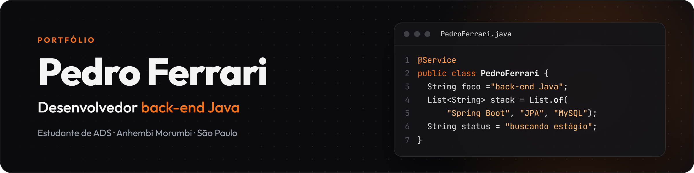
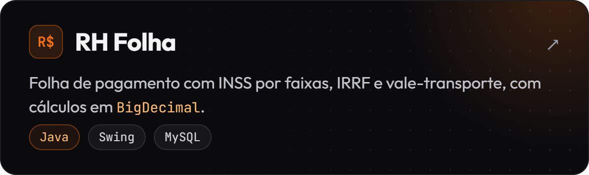
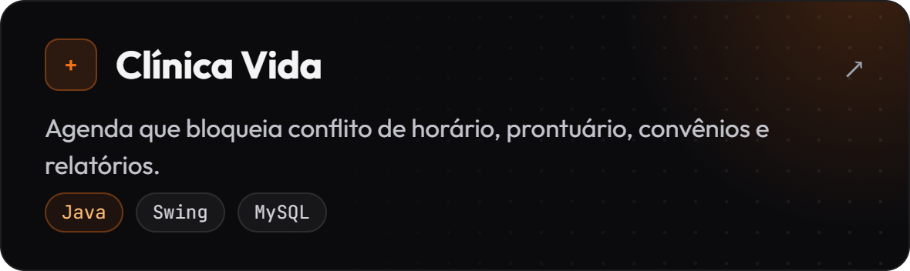
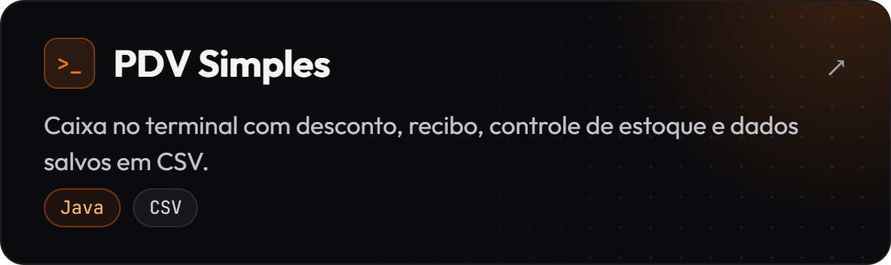
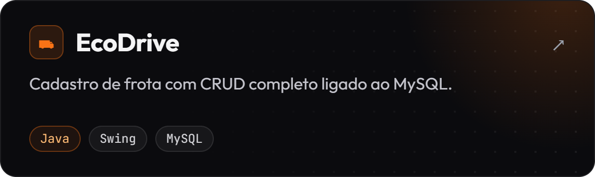
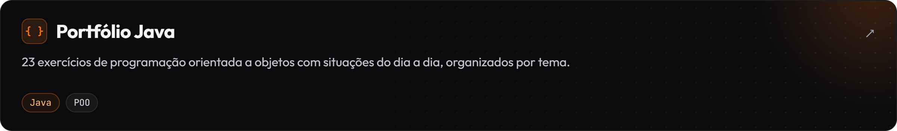
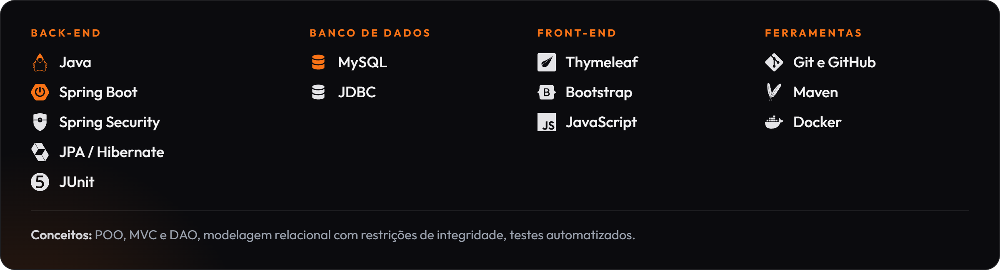

**Desenvolvedor back-end Java** · estudante de Análise e Desenvolvimento de Sistemas (Anhembi Morumbi)  · São Paulo, Brasil

---

Gosto de transformar regra de negócio em sistema que funciona. Cálculo de folha com INSS por faixas, agenda médica que não aceita dois pacientes no mesmo horário, catraca que bloqueia o aluno com mensalidade atrasada: são problemas reais, e é neles que eu mais aprendo.

**Procurando estágio em desenvolvimento back-end Java.**

## Projeto principal: GymSync

**[Testar online como visitante →](https://gymsync-ucfj.onrender.com)** · **[Ver o repositório →](https://github.com/PedroFerrari01/GymSync)**

Sistema web de gestão de academias que desenvolvi do zero, back-end e front-end, com **Java 25, Spring Boot 4, MySQL e Thymeleaf**.

- Matrícula gera as mensalidades; a mensalidade vira atrasada sozinha; a catraca só libera quem está em dia.
- Três perfis (administrador, professor e aluno), protegidos com Spring Security e cobertos por 88 testes automatizados.
- No ar na internet, com proteção CSRF, limite de tentativas de login, recuperação de senha por e-mail e adequação à LGPD.

*O site roda em plano gratuito: a primeira visita pode levar cerca de um minuto para abrir.*

## Outros projetos

## Tecnologias

## Agora

Estudando segurança de aplicações web (Spring Security e testes com o OWASP ZAP) e buscando estágio em back-end Java.

---

[pedrohpferrari@gmail.com](mailto:pedrohpferrari@gmail.com) · [LinkedIn](https://www.linkedin.com/in/pedrohpferrari/)

